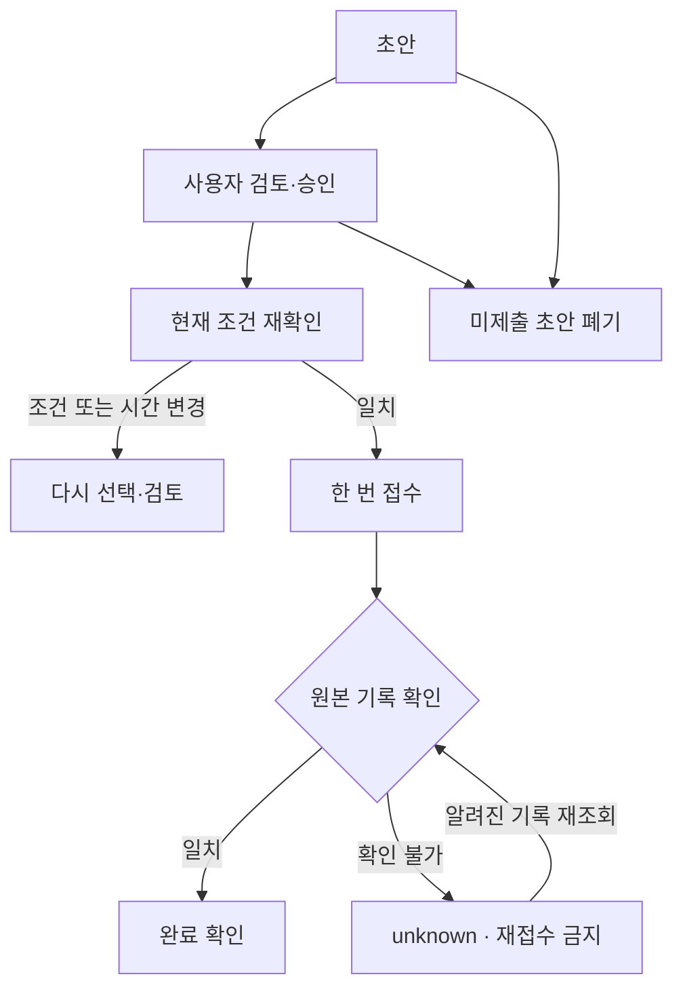

# EasyLayer v0.4 · 전문가 5명 합의안과 인수인계

업데이트: 2026-09-30 KST. 이전 v0.3 파일을 복원한 뒤 Alexa 아키텍처, 음성·화면 UX, 예약 안전성, 품질·재현성, 해커톤 제품·심사 전략을 맡은 **5개 전문 에이전트**가 독립 검토와 상호 검토를 수행했다. 조정 역할에서 의견을 통합하고 실제 코드·문서·테스트에 반영했다. 이는 실제 고객 또는 외부 전문가 5명에게 평가받았다는 뜻이 아니다.

## 먼저 바로잡은 결론

**이번 대회에서는 웹 시뮬레이터로 만드는 것이 맞다.** [공식 FAQ](https://amazonappdev2026.devpost.com/details/faqs)는 참가자가 제한된 Alexa+ 개발 도구 접근권을 신청하거나 받을 수 없다고 명시한다. 자체 웹 화면에서 MCP 서버를 시연하는 경로를 권장하며 공개 호스팅도 필수가 아니다.

따라서 이전의 ‘Alexa 계정·Toolkit 접근부터 확보’는 다음 개발 단계에서 제외했다. 현재 목표는 **예약 조건을 쉽게 고르고, 중단해도 이어가며, 원본 기록 확인 후에만 완료를 알리는 하나의 예약 경험**이다. 실제 Alexa 호출은 향후 접근이 확보될 때 별도 연동한다.

## 5명의 판단과 실제 반영

| 전문가 | 가장 중요한 진단 | v0.4 반영 |
|---|---|---|
| Alexa 아키텍처 | 기존 화면과 MCP 상태가 분리돼 있어 하나의 제품으로 시연하기 어려움 | 새 `/simulator/`가 실제 HTTP MCP 도구를 호출하고 같은 DB·draft_id 사용 |
| 음성·화면 UX | 승인과 완료가 혼동되거나 실패 뒤 오래된 버튼이 남으면 신뢰를 잃음 | 선택→검토→완료 확인, 실패 시 실행 잠금, 원문 기반 큰 글씨 요약과 제한 명령 |
| 예약 안전성 | 별도 초안을 만들면 같은 슬롯의 불확실한 접수를 우회할 수 있음 | 같은 소유자·같은 대상의 중복 실행 억제, 재개, 미제출 초안 폐기, 연락처 정리 |
| 품질·재현성 | 이전 테스트가 실제 NativeSource 어댑터의 전체 HTTP 흐름을 거치지 않음 | 쿠키·CSRF·form·등록·재조회 계약 테스트와 실제 원본 실행용 러너 |
| 제품·심사 전략 | ‘MCP API 연결’만으로는 사용 이유·차별성이 약함 | ‘아까 하던 예약을 이어서, 두 번 접수하지 않게’ 데모와 사용자 관찰 계획 |

전문가별 근거와 동료 검토는 `docs/EXPERT_01_…`부터 `EXPERT_05_…`에 포함했다.

## 검토 중 달라진 결정

1. **플랫폼 연결부터 → 원본 예약 완료부터.** 공식 FAQ를 근거로 도구 접근 대기를 개발 전제에서 제거했다.
2. **새 사이트를 따로 만들기 → 같은 상태를 보여주는 화면.** 기존 v0.2 화면은 연구용으로 남기고 제출용 진입점을 새 공유 시뮬레이터로 고정했다.
3. **자동 재시도 → 결과 확인.** 모호한 접수를 다시 보내면 중복 예약이 될 수 있다. 원본 식별자가 있으면 재조회하고, 없으면 unknown을 유지한다.
4. **음성 기능 수 늘리기 → 사용자의 검토와 정확한 완료.** 음성은 선택·조회·요약을 돕는다. 승인과 접수는 명확한 화면 동작이다. 완전한 자유 대화나 voice-only 예약으로 설명하지 않는다.
5. **실제 원본 영상으로 포장 → 실행한 범위별 증거.** 자동 테스트의 원본은 fixture다. 실제 PHP 원본 E2E를 통과한 뒤에만 성공 예약을 촬영한다.

## 이번에 구현한 것

- 하나의 웹 화면에서 원본 카탈로그와 시간 조회, 초안 생성, 별도 검토 링크, 승인 확인, 접수와 검증 결과를 사용한다.
- `resume_booking`: 서버가 소유자를 확인하고 이전 작업을 복원한다. pending/unknown을 우선하며, 미승인 초안의 검토 링크만 교체한다.
- `cancel_booking_draft`: 아직 보내지 않은 초안만 폐기한다. 확정 예약 취소 기능이 아니다.
- 같은 DB·사용자·서비스·담당자·날짜·시간의 pending/unknown/verified가 존재하면 별도 초안의 재접수를 막는다.
- 가격·필수 필드·담당자·시간이 달라지면 기존 승인을 그대로 실행하지 않는다. 새 초안과 새 검토가 필요하다.
- 전송 시작 시 DB의 연락처를 비우고, POST 전 실패로 approved로 돌아올 때만 다시 보관한다. 만료·취소 등에서 논리적으로 정리한다.
- 새 호스트는 local 모드에서만 활성화된다. 세션·CSRF·Host·Origin과 도구 허용 목록을 검사하며 MCP bearer는 서버에 둔다.
- 읽어주기와 선택적 음성 입력을 제공한다. 인식된 문장을 사용자가 확인한 후 실행하며 음성 자체로 승인하지 않는다.
- `earlier`/`later`는 원본이 반환한 현재 시간 목록에서만 앞뒤 항목을 고른다. `resume booking`, `find times`, `read summary`, `check status`도 한정 명령이다. LLM 호출이 아니다.

## 예약 상태를 어떻게 다루는가



여기서 완료 확인은 원본 기록을 읽어 요약과 대조했다는 뜻이다. 원본에서 나중에 변경·취소된 예약까지 계속 동기화한다는 뜻은 아니다. 동일 DB 보존이 전제이며 여러 DB나 사용자에 걸친 범용 exactly-once 보장은 하지 않는다.

## 검증 결과를 읽는 법

**이번 로컬 자동 검증은 117개 테스트 통과**: JavaScript 47, 브리지 33, 생명주기 12, 원본 HTTP 계약 15, 기존 planner 10. MCP Apps 빌드와 원본 ZIP 해시 확인도 통과했다. 아래 구분처럼 fixture·jsdom 기반 검증이며 실제 원본/브라우저/사용자 효과를 검증한 수치는 아니다.

최종 실행의 명령·통과 여부·실제 테스트 수는 `evidence/release-checks.json`과 `evidence/local-*.txt`가 기준이다. 자동 테스트 수는 사용자 편의·안전성 개선률로 환산하지 않는다.

| 범위 | 이번 실행 범위 |
|---|---|
| 시뮬레이터 호스트 → MCP → 엔진 → NativeSource → 원본형 HTTP fixture | 실제 로컬 HTTP로 검증 |
| 쿠키·CSRF·사용자 분리·검토·중복 방지·응답 유실 | 코드/HTTP 테스트 |
| 새 UI와 MCP Apps 버튼·상태 | jsdom 검증, 실제 브라우저가 아님 |
| Easy!Appointments PHP/MariaDB 실제 실행 | 미실행: 현재 환경에 Docker/PHP/MariaDB 없음 |
| Alexa 실제 기기·계정 연결 | 미실행, 이번 시뮬레이션 경로의 전제 아님 |
| Bedrock 실호출 | 미실행. 기존 별도 planner의 fake-client 테스트만 있음 |
| 실제 브라우저 화면·키보드·음성 | 미실행, 사용자 컴퓨터에서 확인 필요 |
| 실제 사용자 조사·시연 영상·GitHub 공개·제출 | 아직 수행하지 않음 |

## 바로 다음에 할 일

Docker Desktop과 Python 3.12가 있는 컴퓨터에서 ZIP을 풀고, 프로젝트 루트에서 가상환경을 만든다. 자세한 OS별 활성화는 README 또는 Alexa 가이드를 따른다.

```sh
python -m pip install -r bridge/requirements.txt
python scripts/start_demo.py
python scripts/start_bridge.py
```

**http://127.0.0.1:8092/simulator/** 에 접속한다. 다른 터미널에서:

```sh
python scripts/probe_mcp.py --source
python scripts/verify_source_live.py
python scripts/verify_source_live.py --book-fixture
```

마지막 명령은 소유한 테스트 원본에 합성 예약 한 건을 만든다. 실제 고객 정보는 사용하지 않는다. 위 실행이 통과하면 화면에서 직접 검토·승인·완료까지 수행하고 원본 기록과 대조한다. 이 절차가 현재 가장 중요한 남은 검증이다.

이후 일정은 날짜 약속이 아닌 작업 순서다.

| 순서 | 작업 | 완료 증거 |
|---|---|---|
| 1 | 실제 원본 1건 E2E + 화면 조작 | live JSON, 같은 draft/booking 확인, 실제 화면 기록 |
| 2 | 중단 후 재개 + 응답 불확실 사례 | 복원된 상태, 재등록하지 않는 장면 또는 구분된 fault-injection 로그 |
| 3 | 대상 사용자 약 5명 탐색 관찰 | 완료·오선택·도움 요청·이해 여부 원자료. 아직 효과 수치 없음 |
| 4 | 2:45 영어 데모 촬영 | `docs/DEMO_v0.4.md`를 실제 촬영 결과에 맞게 확정 |
| 5 | GitHub와 Devpost 제출 자료 정리 | 코드·라이선스·실행 안내·제품 피드백·영상 |

자유로운 대화가 필요하면 원본 E2E 다음에 좁은 자연어 변경 기능을 연결한다. 기존 Bedrock planner를 메인 흐름에 자동 연결했다고 가정하지 않는다. 모델은 조건 선택을 제안하고 가격·승인·완료 사실은 서버 응답이 결정하도록 유지한다.

## 냉정한 제품 평가

이번 버전은 실제로 이어지는 예약 작업의 기반을 강화했다. 그러나 아직 ‘대화형 예약이 기존 폼보다 낫다’는 사용자 증거가 없다. 초기 대상은 작은 컨트롤과 여러 단계 폼에서 도움이 필요한 성인이라는 가설이다. 원본 폼과 비슷한 과제를 비교해 오선택, 도움 요청, 완료, 승인 내용을 정확히 다시 말하는지 관찰한다. 편의성 수치나 수상 가능성을 만들어내지 않는다.

후순위로 둔 것은 결제, 병원 예약, 보호자 대리 승인, 임의 웹사이트 자동화, 다기관 비교, 원본 예약 취소다. 지금은 **한 예약을 중단해도 이어서, 불확실하면 정확히 멈추는 것**을 보여주는 데 집중한다.

공식 제출 마감: 2026-10-23 12:00 PDT = 한국시간 2026-10-24 04:00 KST. 규칙·FAQ는 제출 직전에 다시 확인한다. 제품의 다섯 에이전트 런타임을 만든 것이 아니라, 다섯 전문 에이전트로 설계·코드·검증을 개선한 결과다.
